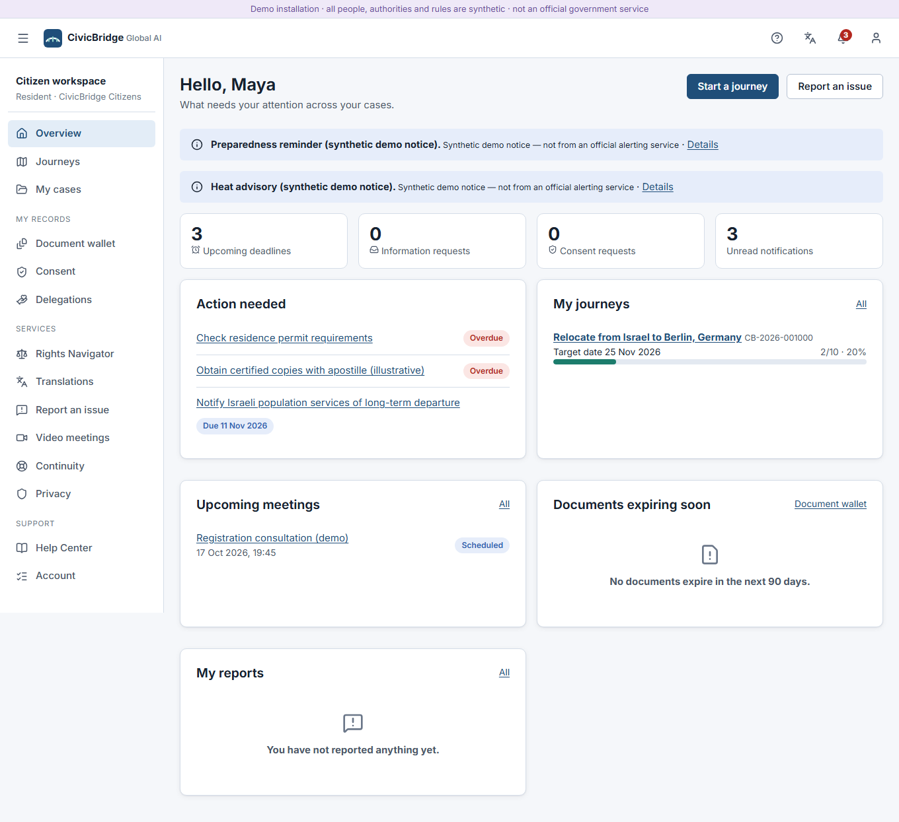
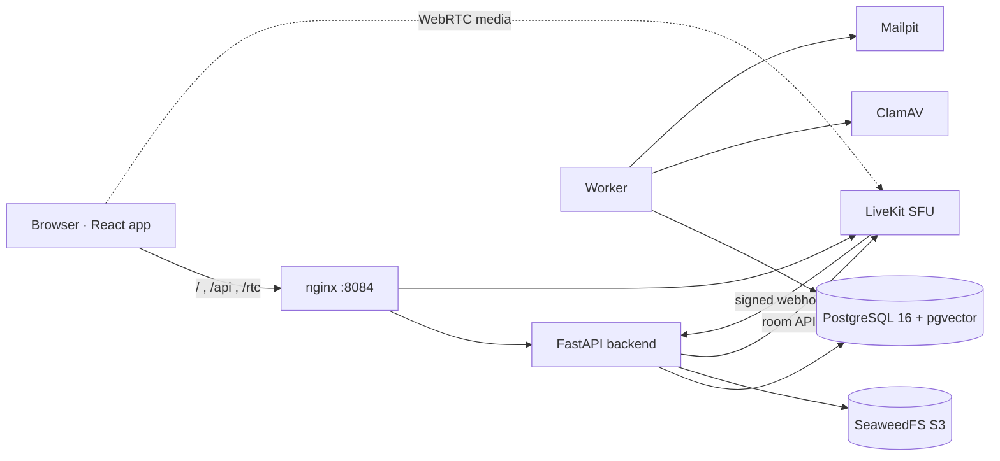
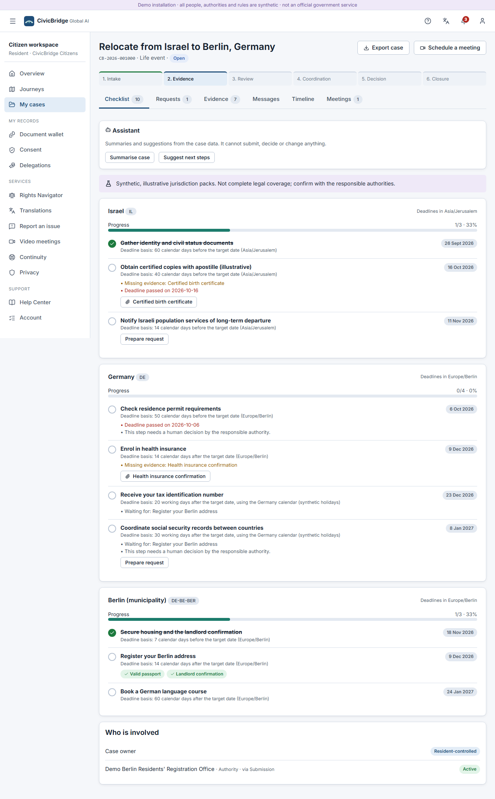
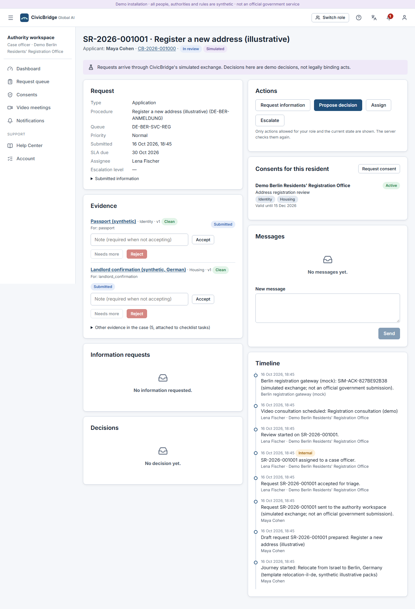
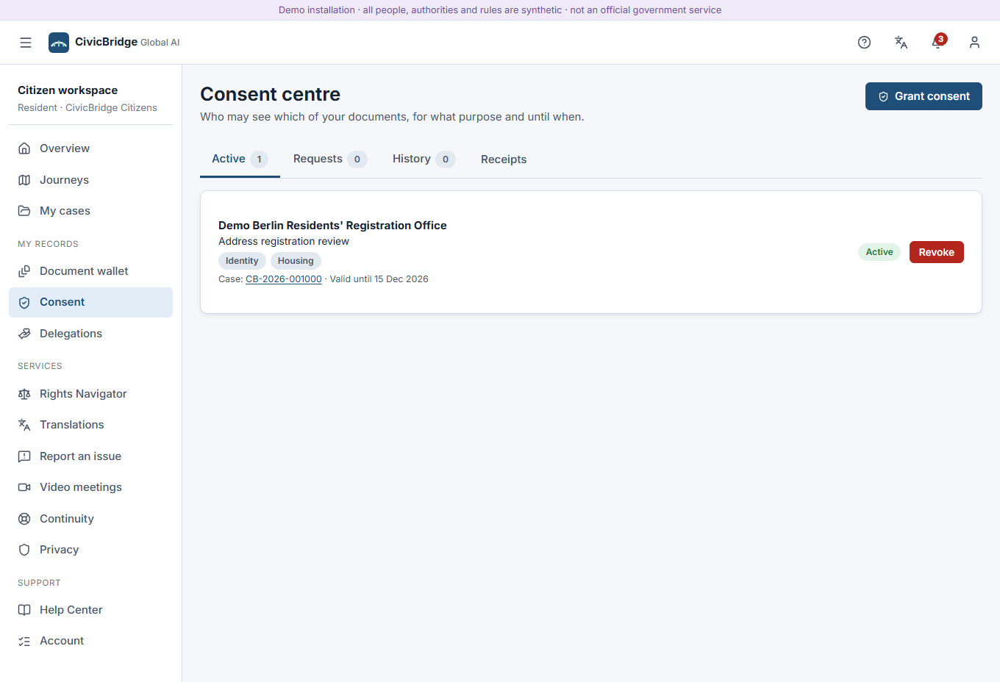
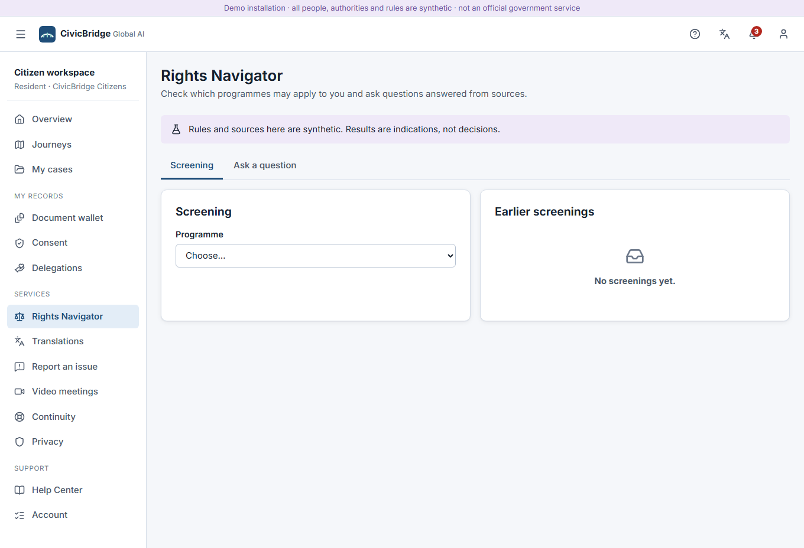
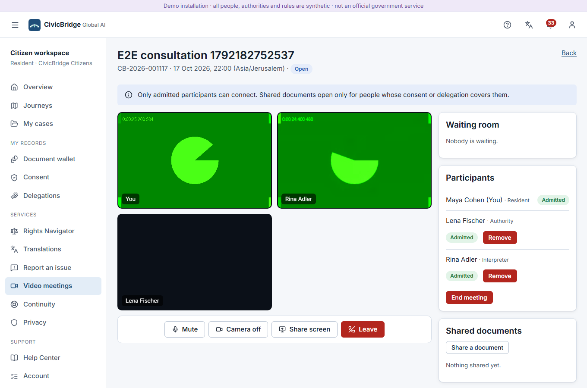
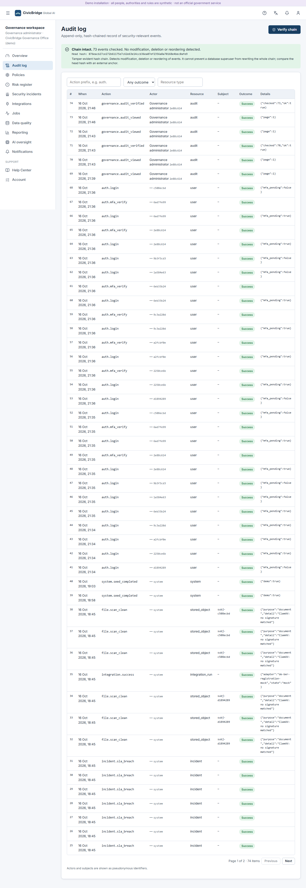
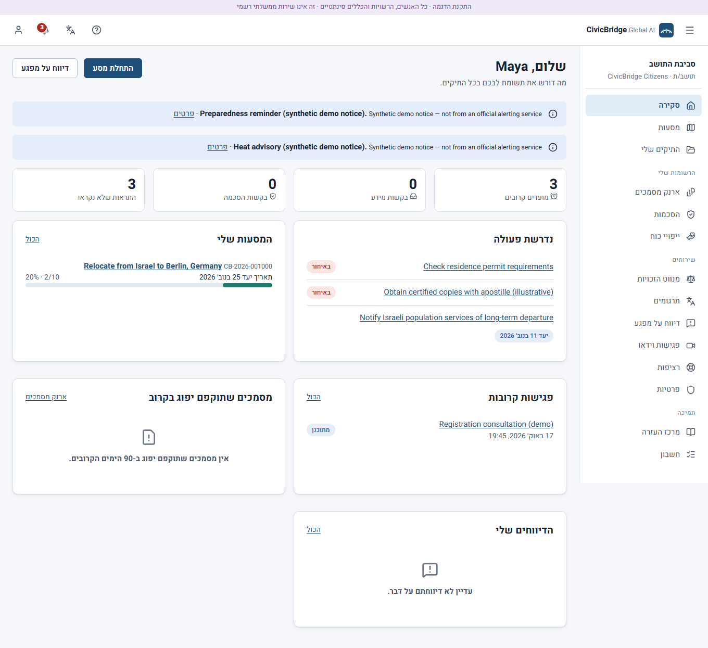
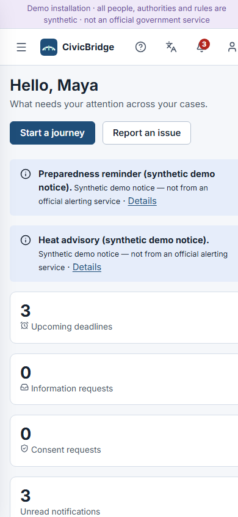

# CivicBridge Global AI

A citizen-controlled workspace for life events that cross borders, and the authority, institution, professional and governance workspaces that work on them — running locally with synthetic data.

> **Demo installation.** All people, authorities, rules and exchanges are synthetic. Nothing here is an official government service, a legal determination or a certified translation, and no real government system is connected.



## What

CivicBridge brings a person's cross-border journey — moving from Israel to Berlin, starting a job, studying, a birth, retiring, opening a business — into one case that the person controls and the responsible organisations work on.

| Workspace | Who | What works |
|---|---|---|
| Citizen | Residents | Life-event journeys with per-country checklists and deadlines, cases and requests, document wallet with malware scanning and redaction, consent and delegation, Rights Navigator, assisted translation, incident reports, video consultations, offline drafts, privacy export and deletion |
| Authority | Case officers, supervisors | Tenant-scoped queue with filters and SLA, request review, information requests, four-eyes decisions, appeals, evidence review, consent requests and handoffs, incident queue, emergency notices |
| Institution | Liaison staff | Cases and documents shared through resident-approved handoffs |
| Professional | Advisers, interpreters | Work within resident delegations (scopes, categories, case, expiry); translation review; meetings |
| Governance | Administrators, auditors | Audit chain verification, policies, risks, security/privacy incidents, integrations, jobs and dead letters, data quality, aggregate reporting, AI oversight — without access to case content |

A public transparency page shows per-authority backlog, SLA adherence and trends with small-group suppression.

## Why

People who move or live across borders deal with several authorities that do not talk to each other. They repeat the same documents, lose track of deadlines in different calendars, cannot see who looked at their papers, and rarely get a clear, reviewable reason for a decision. CivicBridge is built around four ideas:

- **Continuity** — one case, one timeline and one checklist across jurisdictions, usable even when no authority is integrated.
- **Controlled sharing** — documents leave the wallet only under a purpose-bound, time-limited consent or delegation, with a receipt for every view, and revocation that takes effect immediately.
- **Coordination** — authorities, institutions, advisers and interpreters work on the same case through explicit handoffs and case-linked video consultations.
- **Accountable decisions** — server-enforced workflow, information requests that pause the clock, decisions that need two people and a written rationale, appeals that create linked follow-up work, and a hash-chained audit log. AI assists with sources and drafts; people decide.

## How

### Start it

Requirements: Docker with Compose v2.

```bash
docker compose up --build -d
```

Open **http://localhost:8084**. The first start downloads ClamAV signatures (~300 MB, 2–5 minutes); until then uploads stay in "scan in progress". Mail goes to Mailpit at http://localhost:8095.

Demo accounts are generated on first start (never stored in the repository):

```bash
docker compose exec backend python -m app.cli demo-credentials
```

#### Administrator accounts

| | General system administrator | Owner admin username |
|---|---|---|
| Name | `govadmin` (`gov.admin@demo.civicbridge.local`), role *Governance administrator* | `owner-admin` — signs in as `owner-admin@civicbridge.local`, role *Governance administrator* |
| Created by | first start (`app.cli bootstrap`), synthetic demo account with MFA | `app.cli provision-admin` from the values in `.admin-user` (not synthetic, MFA required) |
| Credentials | generated into the `civicbridge_demo` volume; show with `demo-credentials` | `.admin-user` in the project root: username, email, password (generated locally) and the TOTP secret for your authenticator app |
| Version control / images | not in the repository | excluded by `.gitignore` and `.dockerignore` |

The two are deliberately separate: `govadmin` is the shared demo account every installation gets, while `.admin-user` names your own administrator and never leaves your machine. Sign in with the **email** from `.admin-user` (the login form does not accept the username), then the 6-digit code from an authenticator app set up with `totp_secret`. To change the password, edit `.admin-user` and re-run the provisioning (the password goes through stdin, never the command line):

```bash
python -c "import json;kv=dict(l.split('=',1) for l in open('.admin-user') if '=' in l and not l.startswith('#'));print(json.dumps({'email':kv['email'].strip(),'display_name':'Owner Admin','password':kv['password'].strip()}))" | docker compose exec -T backend python -m app.cli provision-admin
```

Re-running keeps the existing TOTP secret and only resets the password and any lockout. `docker compose down -v` deletes this account with all other data; provision it again afterwards.

Stop with `docker compose down` (keeps data). `docker compose down -v` deletes all data and credentials — only when you want to start over. Details: [docs/DOCKER.md](docs/DOCKER.md), walkthroughs: [docs/DEMO.md](docs/DEMO.md).

### Architecture



A modular monolith (FastAPI + one worker on a PostgreSQL job queue) with a React/TypeScript front end. Full diagrams — case lifecycle, consent handoff, video admission — and decisions: [docs/ARCHITECTURE.md](docs/ARCHITECTURE.md).

### User journeys

| | |
|---|---|
|  |  |
| Relocation case: per-jurisdiction checklist, deadlines in local time, missing evidence | Authority review: evidence under consent, actions allowed by state and role, timeline |
|  |  |
| Consent centre with receipts | Rights Navigator: screening with citations and uncertainty |
|  |  |
| Case-linked video consultation, three participants | Governance: audit chain verified |
|  |  |
| Hebrew, right-to-left | Phone width |

All screenshots in [docs/screenshots/](docs/screenshots/) are taken from the running application with synthetic data.

### AI modes

Default `mock`: deterministic, labelled outputs, no model and no downloads. `rules`: no generated text at all. `ollama`: optional local model (not verified here). AI can summarise, suggest next steps, draft messages and decision scaffolds, and answer questions only from cited sources; it can never submit, decide, deny, release records or change a case. Sending an AI-drafted message needs explicit approval. See [docs/AI.md](docs/AI.md).

### Security boundaries

Server-side sessions with CSRF protection, TOTP for privileged roles, deny-by-default authorization with tenant isolation (404 outside your tenant), purpose-bound consent, malware scanning before any file is served, a strict CSP, and an append-only hash-chained audit log. See [docs/SECURITY.md](docs/SECURITY.md).

### Video consultations

Self-hosted LiveKit with a waiting room, host admission, 10-minute room tokens, removal enforced by kick, signed webhook and 10-second reconciliation, and per-viewer authorization for shared documents. Verified with three Chromium participants and fake media devices on one host; LAN and internet use need TLS and network setup: [docs/VIDEO_SETUP.md](docs/VIDEO_SETUP.md).

### Verification

Backend tests run against real PostgreSQL, SeaweedFS, ClamAV, LiveKit and Mailpit; browser tests drive the real UI against the running stack (journeys, multiparty video, accessibility, phone layout). Results and evidence: [docs/VERIFICATION_REPORT.md](docs/VERIFICATION_REPORT.md); requirement mapping: [docs/REQUIREMENTS_TRACEABILITY.md](docs/REQUIREMENTS_TRACEABILITY.md).

```bash
docker compose --profile test run --rm tests          # backend suite (scratch database)
cd frontend && npm ci && npx playwright test           # browser suite against http://localhost:8084
```

### Limitations

Synthetic content only, lexical (not semantic) retrieval, glossary-only mock translation, tamper-evident (not tamper-proof) audit, single-host video verification, partial Hebrew/German translations. The full list: [docs/KNOWN_LIMITATIONS.md](docs/KNOWN_LIMITATIONS.md).

## Documentation

[docs/README.md](docs/README.md) is the index.
