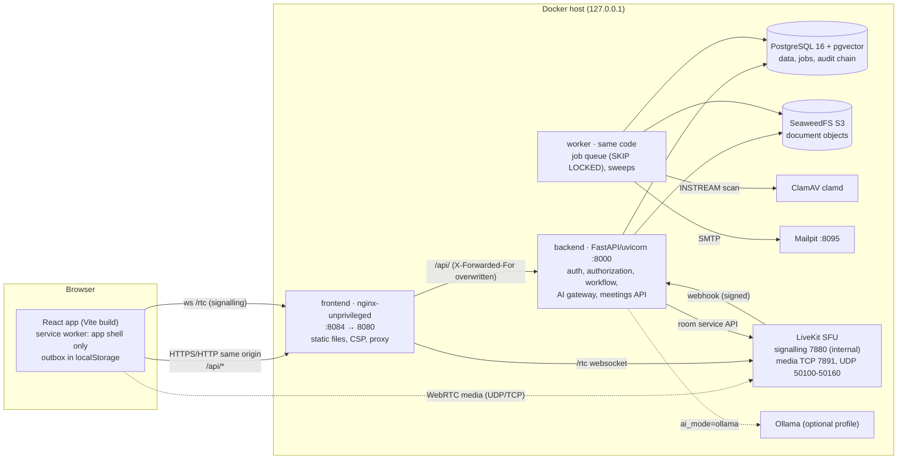
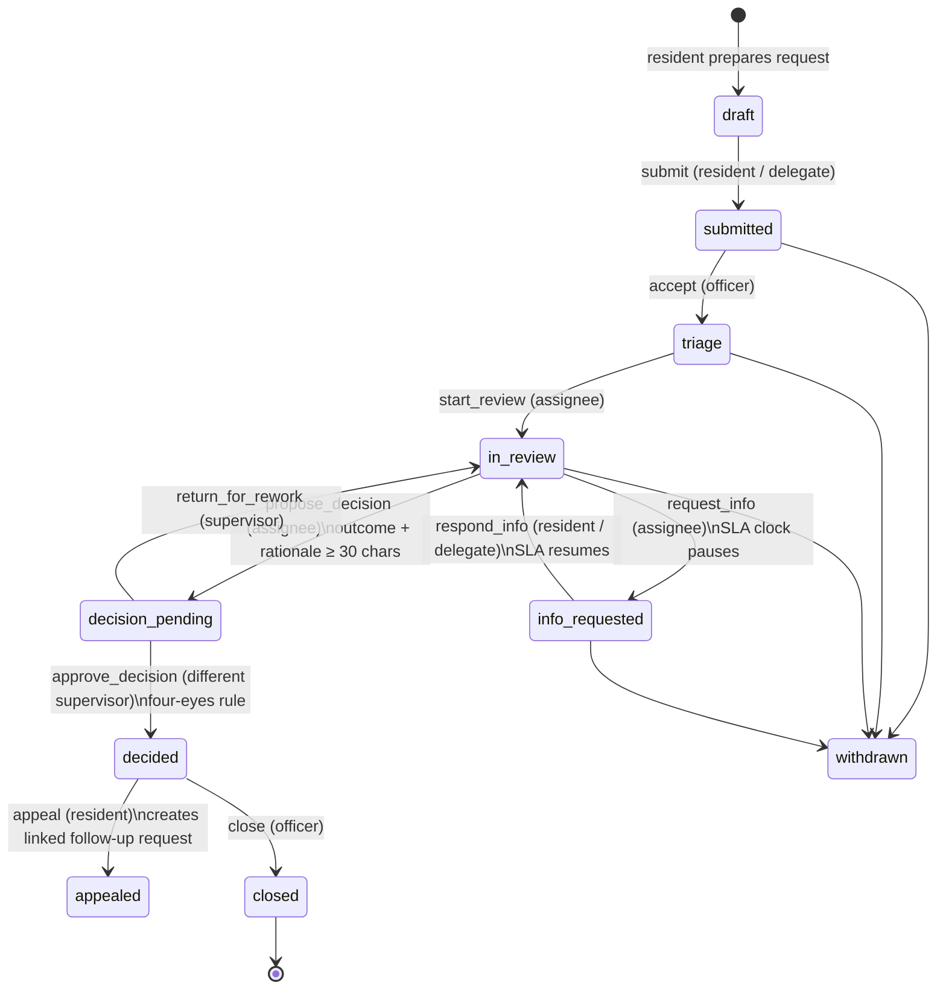
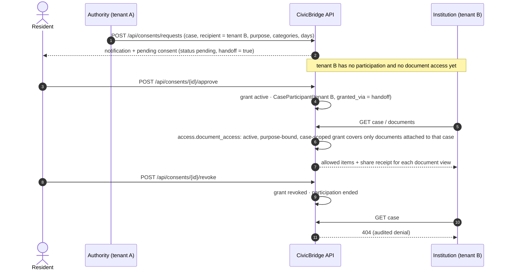
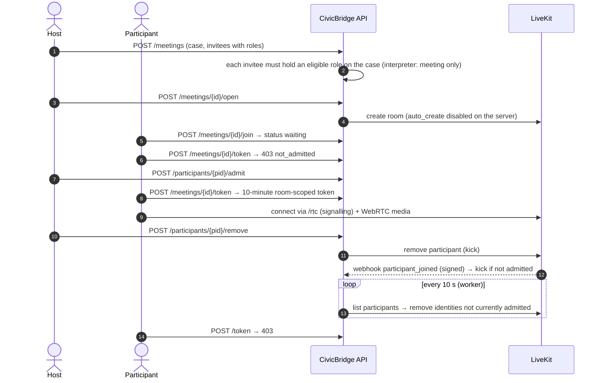

# Architecture and decisions

CivicBridge is a **modular monolith**: one FastAPI backend process, one worker process using the same code base and database, a React single-page app served by nginx, and off-the-shelf infrastructure services. Everything runs locally with `docker compose up --build -d`.

## System architecture

Only nginx (8084), Mailpit (8095) and LiveKit media ports are published, all bound to 127.0.0.1 by default. nginx returns 404 for `/api/metrics`, `/api/integrations/sandbox/*` and `/api/meetings/livekit/webhook`, which are reachable only inside the Docker network.

## Backend layout

| Path | Role |
|---|---|
| `backend/app/main.py` | App factory, routers, error handlers, security headers |
| `backend/app/deps.py` | `get_ctx`: session cookie → user, membership, CSRF/Origin checks, MFA gate, read-only enforcement |
| `backend/app/routers/*` | HTTP API, one module per domain (140 operations) |
| `backend/app/services/*` | Domain logic: `access` (authorization), `workflow`, `calendar`, `incidents`, `meetings`, `audit`, `jobs`, `files`, `scanner`, `storage`, `analytics`, `integrations`, `notify` |
| `backend/app/ai/*` | Rule engine, embeddings, RAG, tool gateway, translation, model provider |
| `backend/app/worker.py` | Job handlers and periodic sweeps |
| `backend/app/cli.py` | Operations CLI (bootstrap, credentials, backup, restore check, audit) |
| `backend/packs/*` | Versioned synthetic jurisdiction packs, templates, glossary, fixtures |
| `backend/alembic/` | Migration `0001_initial` (schema, audit trigger, grants, HNSW index) |

## Frontend layout

| Path | Role |
|---|---|
| `frontend/src/App.tsx` | Routes per workspace, lazy-loaded pages, `Protected` guard, replay on reconnect |
| `frontend/src/lib/` | API client (CSRF header, auth events), auth context, i18n (en/he/de, RTL), offline outbox, preferences |
| `frontend/src/components/` | Shell and navigation, shared UI primitives (accessible fields, modal with focus trap, tabs) |
| `frontend/src/pages/{public,citizen,authority,shared,governance}` | Workspace pages |
| `frontend/src/help/articles.ts` | Help Center content and contextual mapping |
| `frontend/nginx/default.conf.template` | Proxy, CSP and caching rules |
| `frontend/e2e/` | Playwright suites (smoke, journeys, video, accessibility, mobile, screenshots) |

## Case lifecycle and human review

The state machine lives in `backend/app/services/workflow.py`; the server rejects any transition not allowed for the actor and state, and the UI shows only `allowed_actions` returned by the server.

Assignment and escalation are available in every open state. SLA deadlines use working-day calendars per jurisdiction (weekends and synthetic holidays); the worker's SLA sweep flags breaches and escalates. AI can draft a rationale scaffold but cannot call any transition (see [AI.md](AI.md)).

## Consent and controlled cross-tenant handoff

## Video admission and authorization

Documents shared in a meeting are authorized per viewer on every preview (`/meetings/{id}/shared/{doc}/preview`); meeting membership never replaces consent or delegation.

## Key decisions

| Decision | Reason | Consequence |
|---|---|---|
| Modular monolith + one worker | Small team, single deployment unit, transactional consistency | Scale-out needs shared rate limiting (currently in-process) |
| PostgreSQL job queue (`SKIP LOCKED`) instead of a broker | One less service; jobs commit with the data that created them | Throughput bounded by the database; fine for this scale |
| Server-side sessions, HttpOnly cookie, CSRF double-submit + Origin check | No tokens in JavaScript; immediate revocation | Same-origin deployment required (nginx proxy) |
| Deny-by-default authorization in one module (`services/access.py`) | One place to review; tenant isolation returns 404 and is audited | New features must route through it |
| Hash-chained, append-only audit with a restricted DB role | Tamper evidence without extra infrastructure | Not tamper-proof against a database superuser |
| Lexical hash embeddings in pgvector | No model download, deterministic tests | Retrieval quality is lexical, not semantic |
| LiveKit SFU, rooms created only by the backend | Proven WebRTC stack; server-side kick and webhooks | LAN/internet use needs host configuration ([VIDEO_SETUP.md](VIDEO_SETUP.md)) |
| Synthetic adapters with real contracts (idempotency, retries, dead letter) | No real government systems are available or authorized | `authorized_live` state exists in the model but no adapter uses it |
| Offline: app shell cache + per-user outbox, no offline case data | Minimise sensitive data on devices | Reloading without a connection cannot restore the session |
