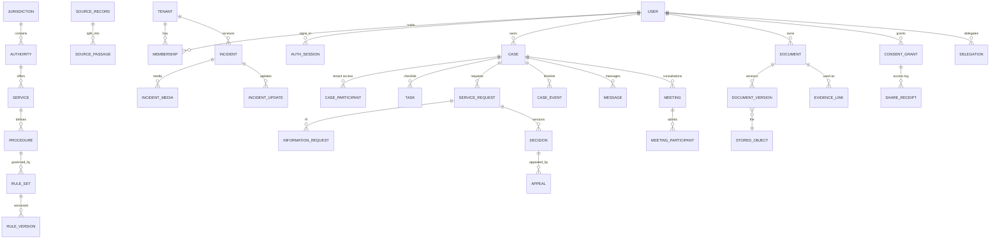

# Data model

SQLAlchemy models in `backend/app/models/`, one Alembic migration (`backend/alembic/versions/0001_initial_schema.py`). 59 application tables (plus `alembic_version`) in PostgreSQL 16 with the pgvector extension.

## Tables by area

| Area | Tables |
|---|---|
| Identity and tenancy | `tenants`, `users`, `memberships`, `auth_sessions`, `one_time_tokens` |
| Jurisdiction content | `jurisdiction_packs`, `jurisdictions`, `holidays`, `authorities`, `services`, `procedures`, `rule_sets`, `rule_versions`, `source_records`, `source_passages` (with `embedding vector`, HNSW index), `workflow_templates` |
| Cases and workflow | `cases`, `case_participants`, `case_events`, `life_events`, `tasks`, `service_requests`, `information_requests`, `decisions`, `appeals`, `screening_results`, `messages` |
| Documents and sharing | `stored_objects`, `documents`, `document_versions`, `document_chunks` (embeddings), `evidence_links`, `consent_grants`, `share_receipts`, `delegations`, `translations` |
| Collaboration and continuity | `notifications`, `notification_preferences`, `drafts`, `sync_operations`, `appointments`, `meetings`, `meeting_participants`, `meeting_shared_documents`, `emergency_notices` |
| Incidents | `incidents`, `incident_media`, `incident_updates` |
| Privacy | `privacy_requests` |
| Operations and governance | `audit_events`, `jobs`, `worker_heartbeats`, `policies`, `risks`, `security_incidents`, `integration_adapters`, `integration_runs`, `ai_tool_calls`, `analytics_snapshots` |

## Conventions

- UUID primary keys; `created_at`/`updated_at` in UTC; local times are converted with the jurisdiction or user time zone at the edges.
- Human references from a database sequence: `CB-YYYY-NNNNNN` (cases), `SR-…` (service requests), `INC-…` (incidents).
- Optimistic concurrency on service requests (`version`, `expected_version` on actions) and drafts (`base_version`).
- Soft deletion (`deleted_at`) for documents and drafts; storage objects are erased by worker jobs.
- `audit_events` has a `seq`, `prev_hash` and `hash`, an append-only trigger, and only SELECT/INSERT for the runtime role.
- `stored_objects.scan_status`: `pending`, `clean`, `infected`, `scan_unavailable`, `error`.
- Synthetic content is flagged (`synthetic`, `is_placeholder`, `verification_status`) and carried to the UI.
